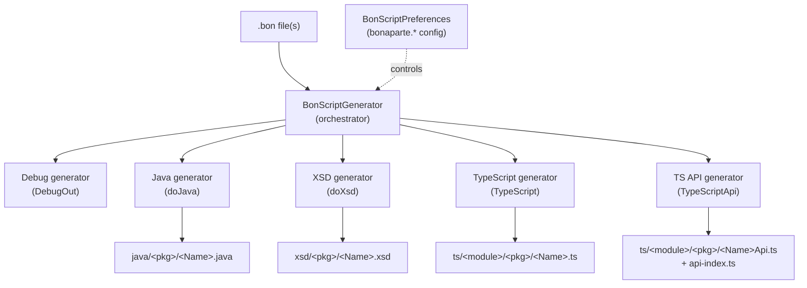

# 1. Overview

Bonaparte DSL is an [Xtext](https://www.eclipse.org/Xtext/)-based domain-specific language (DSL)
for describing **external interfaces and persistence models**. A single `.bon` source file is the
single source of truth from which the framework generates:

- **Java** POJOs with hand-rolled, low-GC `serialize`/`deserialize` methods, validation, comparison,
  and optional JAXB / `Externalizable` / Hazelcast / Bean-Validation support.
- **XSD** XML schemas (optional).
- **TypeScript** model types that mirror the wire format (optional).
- **TypeScript** Angular RPC API clients for recognized request/response patterns (optional).

The design goal is *fast, low-GC serialization*: instead of relying on reflection-heavy frameworks,
the generator emits explicit, tight loops that read and write each field directly.

## What a `.bon` file describes

A `.bon` file is a small, typed language. At its core it defines:

- **Packages** — loosely correspond to Java packages; carry package-level defaults and properties.
- **Type definitions** (`type`) — named aliases for a data type.
- **Enums** (`enum`) — numeric or alphabetic (token) enumerations.
- **Enum sets** (`enumset`, `xenumset`) — bitmaps over an enum.
- **Classes** (`class`) — the main data carriers, with fields, generics, inheritance, and a rich set
  of modifiers (RTTI, key/ref classes, tracking, XML, Hazelcast, …).

See [DSL Syntax](02-dsl-syntax.md) for the full grammar.

## The generator pipeline

All generation is driven by a single orchestrator,
[`BonScriptGenerator`](../de.jpaw.bonaparte.dsl/src/de/jpaw/bonaparte/dsl/generator/BonScriptGenerator.xtend),
which extends Xtext's `AbstractGenerator`. For each `.bon` resource it:

1. Attaches the Maven **ownership context** (if present) to the resource set.
2. Runs each enabled generator in a fixed order:

| Order | Generator | Enabled when | Output |
|-------|-----------|--------------|--------|
| 1 | `DebugBonScriptGeneratorMain` | `bonaparte.DebugOut` | Human-readable model dump |
| 2 | `JavaBonScriptGeneratorMain` | `bonaparte.doJava` (default **true**) | Java sources |
| 3 | `XsdBonScriptGeneratorMain` | `bonaparte.doXsd` (default **true**) | XSD schemas |
| 4 | `TypeScriptBonScriptGeneratorMain` | `bonaparte.TypeScript` (default **false**) | TypeScript models |
| 5 | `TsApiClientGenerator` | `bonaparte.TypeScriptApi` (default **false**) | TypeScript API clients |

The orchestrator also computes the `jakarta` vs `javax` prefix once (from `bonaparte.jakarta`,
default **true**) and passes it to the Java generator.

Each generator is an independent class that receives the parsed EMF resource and an
`IFileSystemAccess2` (the Xtext abstraction for writing output files). They never talk to each
other directly; they only share the parsed model and the preferences.

## The three generators in scope

This documentation set focuses on the three generators named in the task:

| Generator | File | Document |
|-----------|------|----------|
| **Java** | `generator/java/JavaBonScriptGeneratorMain.xtend` | [Java Generator](03-java-generator.md) |
| **TypeScript** | `generator/ts/TypeScriptBonScriptGeneratorMain.xtend` | [TypeScript Generator](04-typescript-generator.md) |
| **TypeScript API** | `generator/tsapi/TsApiClientGenerator.xtend` | [TypeScript API Generator](05-typescript-api-generator.md) |

The XSD and debug generators exist but are out of scope here.

## Support libraries

The generated code is not self-contained; it compiles against runtime libraries:

### Java — `bonaparte-java`

The generated Java classes implement interfaces and call helpers from the **`bonaparte-java`**
project (group `de.jpaw.bonaparte`). Key runtime types referenced by generated code:

- `BonaPortable` / `BonaPortableRef` — the base interfaces for serializable / reference classes.
- `MessageParser` / `MessageComposer` — the low-level binary read/write primitives.
- `DataConverter` — type conversion helpers.
- `StaticMeta` — static metadata registry.
- `de.jpaw.bonaparte.annotation.*` — annotations such as `@RelatedKey`, `@IsRefClass`, `@KeyClass`,
  `@TrackingClass`.

Two package names are fixed constants in the generator (not user-configurable):

- `de.jpaw.bonaparte.core` (`bonaparteInterfacesPackage`) — where the runtime interfaces above live.
- `de.jpaw.bonaparte.pojos` (`bonaparteClassDefaultPackagePrefix`) — the default Java package prefix
  used when a `.bon` package has no explicit `(prefix)`. The generated `meta` classes are imported
  from `<prefix>.meta.*`.

### TypeScript — `bonaparte-core` and `t9t-base-api`

The generated TypeScript imports from npm packages:

- **`@arvato-systems-jacs/bonaparte/bonaparte-core`** — provides `BonaPortable` and the core
  portable support. A module *generates* its own `bona-portable.ts` only when it is the
  `bonaparte-core` artifact (or when no module is configured); otherwise it imports from this package.
- **`com.arvato-systems.t9t:t9t-base-api`** (npm) — provides the RPC runtime: `RpcClient`, and the
  `unwrap*` helpers (`unwrapCrud`, `unwrapSearch`, `unwrapVoid`, …) used by the API generator.

The exact import specifiers are resolved by the **module system** described in
[TypeScript Generator](04-typescript-generator.md#the-module-system).

## How generation is triggered

There are two supported hosts:

1. **Eclipse** — the DSL ships an editor, content assist, and validation. Generation runs on save /
   build using the `bonaparte.*` preferences (system properties or `BONAPARTE_*` environment
   variables). Module ownership is configured via `bonaparte.TypeScript.module` and friends.
2. **Maven** — the `xtext-maven-plugin` compiles `.bon` files and runs the generators during the
   `process-sources` phase. The `bonaparte-typescript-maven-plugin` adds Maven-aware **ownership**
   (so cross-module imports resolve to the correct npm packages). See
   [Maven Integration](06-maven-integration.md).

## Versioning

The project version is `6.6.3-SNAPSHOT`. The Eclipse update site is published at
<https://arvato-systems-jacs.github.io/bonaparte-dsl/>.

## Where to go next

- Learn the language: [DSL Syntax](02-dsl-syntax.md)
- Understand each generator: [Java](03-java-generator.md) · [TypeScript](04-typescript-generator.md) · [TS API](05-typescript-api-generator.md)
- Wire it into your build: [Maven Integration](06-maven-integration.md)
- Look up a setting: [Configuration Reference](07-configuration-reference.md)
- See it in action: [Examples](08-examples.md)
