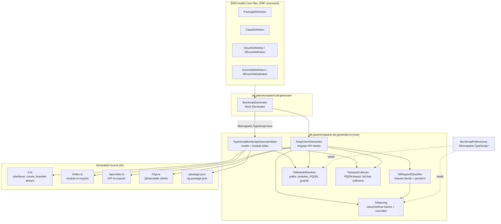
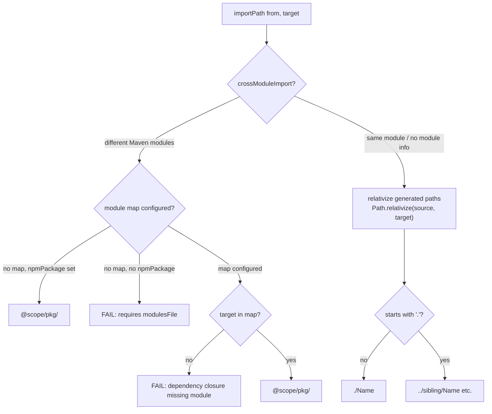
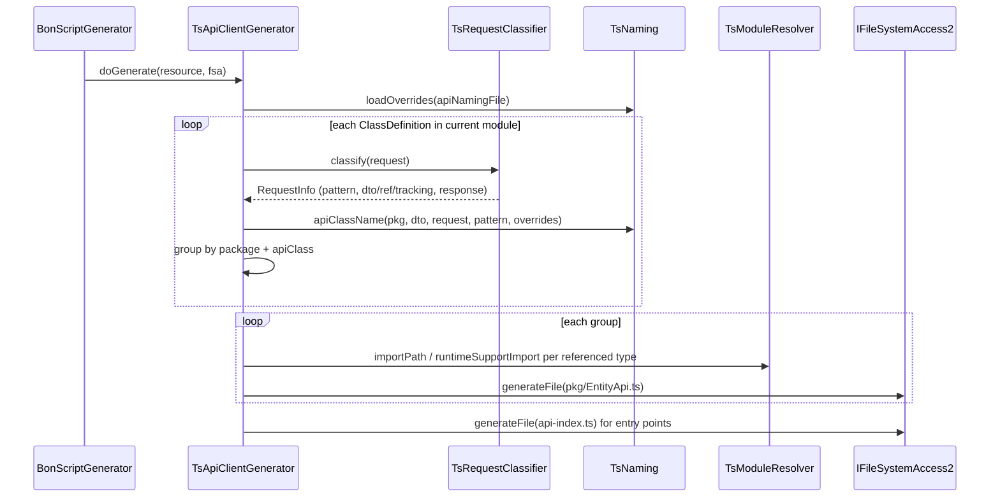

# feature/DSL-9998 — TypeScript Generator for the Bonaparte DSL

> **Branch:** `feature/DSL-9998` (13 commits ahead of `master`, merge base `cb40275d`)
> **Scope:** A new, optional TypeScript code generator for the Bonaparte DSL, plus a
> path-based import resolver that replaces fragile package-depth arithmetic.
> **Design reference:** [../../IMPLEMENTATION-PLAN-TS-IMPORT-RESOLUTION.md](../../IMPLEMENTATION-PLAN-TS-IMPORT-RESOLUTION.md)

The Bonaparte DSL (`.bon` files) previously generated Java only. This branch adds a
second target: **TypeScript wire-contract types and Angular API clients**, enabled by a
single system property. The generated TypeScript is a *structural* projection of the
BON model — interfaces, const objects, and branded aliases that mirror the JSON wire
format of a live bonaparte server — not a port of the executable Java domain classes.

---

## Current implementation status (2026-10-13)

Bonaparte generation now uses the production `bonaparte-typescript-maven-plugin`
(`de.jpaw.bonaparte-dsl:bonaparte-typescript-maven-plugin:6.6.3-SNAPSHOT`), a normal
Maven module registered in the DSL reactor and inheriting `pluginparent`. Its
`generate` Mojo extends `XtextGenerateMojo` and derives immutable ownership/location
context from the current project and actual compile dependency closure, using reactor
models or Maven/Aether-resolved POMs for external BON-bearing JARs. The context is
delivered through `BonScriptMavenSetup` and attached to the resource set at generator
entry because the standalone Xtext builder may use resource sets outside the language
provider. `TsModuleResolver` prefers this context for imports, module identity, and
output folders; API-index paths also use resource context. Unknown BON ownership
fails, JVM helper `java:/` resources are excluded, and canonical export/alias policy
is retained. Scoped thread-local bootstrap is restored after use; the injector
captures immutable context.

The Bonaparte Maven profile uses the new plugin and skips the old Xtext generation
only when `ts.models=true`, preserving the same BON+JPA language setup. Its POM no
longer declares the four ownership system properties. The production adapter and
root profiles are now migrated in t9t and a28 as well; a28's four ownership system
properties and both mapping files have been removed. Legacy preference fallbacks
remain for downstream projects and Eclipse.

Verified for this implementation: Java 21 adapter install; all 43
`TypeScriptGeneratorTest` tests; clean Bonaparte generation; all nine ng-packagr
entry points; npm `tsc`; focused Maven verify/tarball packaging (typecheck run
separately); and installed-JAR Auth generation with deliberately invalid legacy
settings and nonexistent mapping-file paths, producing correct Auth/core imports.
t9t's current root build passed `mvn -Dts-api=true clean generate-sources` and
`mvn -Dts-api=true verify -DskipTests` across 32 modules without selectors. All
24 npm entry points compiled; npm typecheck and 52 runtime tests passed separately.
Its `@arvato-systems-jacs/t9t@10.0.0-snapshot.20261013155153` package was
published only to local Verdaccio and passed a fresh strict TypeScript `NodeNext`
and runtime-import consumer check against the exact Bonaparte snapshot. The DSL's
43 generator tests pass. a28's root profiles, ownership migration, and assembly
were verified; all 38 entry points compile and pass strict typechecking. Its
`@arvato-systems-jacs/a28@10.0.0-snapshot.20261013162307` package was published
only to local Verdaccio against t9t
`@arvato-systems-jacs/t9t@10.0.0-snapshot.20261013155153` and Bonaparte
`@arvato-systems-jacs/bonaparte@7.3.3-snapshot.20261013124124`. A production
Angular build using these published packages passed. Playwright verified role and
product requests against mocked `/rpc`, rendered results, error propagation, and
390px layout without overflow; no live backend was used. Project migration,
Eclipse fallback removal, writable Maven distribution, and remote publishing
remain open. No full Bonaparte-to-project chain is claimed.

---

## 1. What changed

The table below records the original feature-branch snapshot and predates the
production Maven ownership adapter:

| Area | Files | Purpose |
|---|---|---|
| New generator package | `de.jpaw.bonaparte.dsl/src/de/jpaw/bonaparte/dsl/generator/ts/` | The TypeScript generator and its helpers (see §2) |
| Generator wiring | `BonScriptGenerator.xtend` | Runs the TS generators when `-Dbonaparte.TypeScript=true` |
| Preferences | `BonScriptPreferences.xtend` | Six new `bonaparte.TypeScript.*` settings |
| Manifest | `de.jpaw.bonaparte.dsl/META-INF/MANIFEST.MF` | Exports the new `generator.ts` package |
| New test module | `de.jpaw.bonaparte.dsl.tests/` | 34 JUnit tests for the generator (new Maven module) |
| Consumer verification | `scripts/verify-ts-consumers.sh` | Regenerates real a28/Takko consumers and checks signatures |
| Plan | `IMPLEMENTATION-PLAN-TS-IMPORT-RESOLUTION.md` | Phased plan + Java-parity audit (all phases done) |

### Commit history (oldest → newest)

```
554b047f  DSL-9998: add optional TypeScript generator (-Dbonaparte.TypeScript=true)
cb545cc1  DSL-9998: enhance TypeScript generator with deprecated markers and type mappings
b82f45a1  feat(ts): module support and API client generation
55453b80  feat(ts): generator tests + verification script for API signatures
18e80267  feat(ts): API generation with paging support
8ae559cb  feat(ts): API naming overrides and improved method handling
40604743  feat(ts): tests for API generation from A28 request examples
873e1298  feat(ts): entry point support and module exports
2e47fbf9  feat(ts): dynamic system property support and module handling
6a7e8365  feat(ts): polymorphic type handling
9b7135bf  feat(ts): import resolution plan — eliminate package-depth arithmetic
ae341a94  Refactor TypeScript generation for module resolution and import handling
9ce165a8  feat(ts): additional field types and JSON serialization formats
```

---

## 2. Added classes and their purpose

All new production code lives in `de.jpaw.bonaparte.dsl/src/de/jpaw/bonaparte/dsl/generator/ts/`.

### `TypeScriptBonScriptGeneratorMain.xtend` (518 lines)

The main Xtext generator (`AbstractGenerator`). For every BON resource in the current
module (plus included modules) it emits **one `.ts` file per BON type** under
`ts/<entry-point>/<bon-package-path>/`:

- `EnumDefinition` → `const` object + union type. Numeric enums map to ordinals
  (`ASC: 0`), alpha enums to token strings (`A: "a"`).
- `XEnumDefinition` → open `type X = string` (xenum factories compose tokens across
  inheritance, so the closed union is intentionally not emitted).
- `EnumSetDefinition` → branded `number`/`string` bitmap alias carrying the PQON.
- `XEnumSetDefinition` → branded string alias carrying set + xenum PQONs.
- `ClassDefinition` → `interface` with:
  - `export const <Name>PQON = "<package>.<Name>" as const;`
  - fields mapped to TS types (see §5 wire-format table), optional fields as `?` and
    `| null`, aggregates as `T[]` / `Record<string, T>`
  - `'@PQON': typeof <Name>PQON;` discriminator field
  - `extends Omit<Parent, '@PQON'>` for inheritance
  - a type guard `is<Name>(value: unknown): value is <Name>` when the parent lives in
    another module
  - JSDoc `@bonaparte.*` metadata tags (requiredness, defaults, wire format, length /
    pattern / precision constraints, map key format, custom properties)
  - polymorphic fields of an abstract base type expand to a union of all concrete
    descendants in the module set
- Per entry point: `package.json`, `ng-package.json`, `index.ts` (module index with
  re-exports), and a placeholder `api-index.ts`.

### `TsApiClientGenerator.xtend` (370 lines)

Generates **Angular `@Injectable` API client classes** from BON request classes. For
each classified request family it emits one `<Entity>Api` class whose methods call
`RpcClient.call(<Request>PQON, params)` and map the response through an unwrap helper:

- `search(params)` / `leanSearch(params)` — paged, `offset` defaulted to `0`
- `execute<Variant>(params)` plus `create` / `read` / `update` / `delete` for CRUD
  request families (surrogate, string, composite, module key)
- `resolve(key)` / `resolveMany(params)` for resolver requests
- request parameter types are `Omit<Request, '@PQON' | ...>` so callers never set the
  discriminator; paging and "extras" fields are split into a generated
  `<Request>Extras` interface
- writes `api-index.ts` re-exporting all API classes (with collision-safe aliasing)

### `TsRequestClassifier.xtend` (215 lines)

Static classifier that walks a request class's **generic inheritance chain** and
recognizes the standard t9t request families by their base-class names:

| Base class | Pattern |
|---|---|
| `SearchRequest<DATA, TRACKING>` | `SEARCH` |
| `LeanSearchRequest` | `LEAN_SEARCH` |
| `CrudSurrogateKeyRequest<REF, DATA, TRACKING>` | `CRUD_SURROGATE` |
| `CrudStringKeyRequest<DATA, TRACKING>` | `CRUD_STRING` |
| `CrudCompositeKeyRequest<REF, DATA, TRACKING>` | `CRUD_COMPOSITE` |
| `CrudModuleCfgRequest<DATA, TRACKING>` | `CRUD_MODULE` |
| `RefResolverRequest<REF>` | `RESOLVE` |
| `MassResolverRequest` | `RESOLVE_MANY` |
| `RequestParameters` | `SPECIAL` |

It resolves generic type parameters through intermediate abstract classes (e.g.
`class MySearch extends AbstractSearch<ProductDTO>` where
`AbstractSearch<T> extends SearchRequest<!T, Audit>`), extracts the `DATA`/`REF`/
`TRACKING` type names, and classifies the response (`SearchResponse`,
`CrudAnyKeyResponse`, `RefResolverResponse`, `MassResolverResponse`,
`LeanSearchResponse`, `ServiceResponse`) to pick the right unwrap helper and result
type. A search/CRUD request whose response does not match the expected family is
downgraded to `SPECIAL` (still generated, but with a plain method).

### `TsNaming.xtend` (137 lines)

Derives stable **API class and method names**:

- API class: `<Entity>Api` from the DTO name (`ProductDTO` → `ProductApi`), or from
  the request name's entity stem, or from the package name as a fallback.
- Method: `search`, `leanSearch`, `create`/`execute*`, `resolve`, `resolveMany`, or
  the lower-camel request stem; pattern markers (`Search`, `Crud`, `Resolver`,
  `MassResolver`) are stripped from the remainder to form the suffix
  (`ProductSearchRequest` → `search`, `SkuMassResolverRequest` → `resolveMany`).
- API names are derived automatically; no naming-override file is required or read.

### `TsModuleResolver.java`

The heart of the import-resolution work. A static utility that owns:

  - **Module identity** — the production Maven path prefers attached immutable
  ownership context, which maps BON resources to owners from reactor models or
  Maven/Aether-resolved dependency models. Standalone and unmigrated project
  consumers retain the earlier fallback behavior.
- **Output layout** — `outputFolder(Resource)` = `ts/<entry-point>/`, with the
  production entry point derived from the owning Maven artifactId and repository
  package context.
- **Same-entrypoint imports** — `importPath(from, fromName, target, targetName)`
  relativizes the *actual generated file paths* (`Path.relativize`), producing
  `./Name`, `../sibling/Name`, etc. No counting of BON package segments.
- **Cross-module imports** — the production Bonaparte and t9t paths use attached Maven
  ownership context to emit the owning repository package plus exact artifactId
  entry point. Unknown ownership fails generation. Legacy map-based fallbacks remain
  only for not-yet-migrated consumers and Eclipse.
- **Portable type support** — only the `bonaparte-core` entry point generates
  `bona-portable.ts` and exports `BonaPortable`. Configured non-core model/API
  modules import `@arvato-systems-jacs/bonaparte/bonaparte-core`; core types use
  the local generated file. Unconfigured standalone generation emits one local
  definition. Assembly copies files unchanged; it does not add exports or copies.
- **RPC runtime imports** — t9t and a28 runtime imports are verified from their
  locally published packages in a fresh registry consumer and Angular app.
  Project ownership and the legacy fallback for unmigrated consumers and Eclipse
  remain to be migrated.
- **PQON / package path / type guard** helpers shared by both generators.

### `TsImportCollector.java` (43 lines)

The TypeScript counterpart of the Java generator's `ImportCollector`. Collects
referenced BON types **keyed by canonical BON identity (PQON)** instead of simple
name, and **fails fast** with a clear error when two different BON types share a
TypeScript simple name (ambiguous import). Used by the model generator, the module
index, and the API generator so the collision policy is uniform.

### Supporting changes

- `BonScriptPreferences.xtend` — TypeScript settings, including legacy fallbacks
  retained for unmigrated consumers and Eclipse (see §4).
- `BonScriptGenerator.xtend` — receives context through `BonScriptMavenSetup` and
  attaches it to the resource set before running the TypeScript generators.
- `bonaparte-typescript-maven-plugin/` — production Maven adapter; its `generate`
  Mojo extends `XtextGenerateMojo` and derives the immutable ownership context.
- `de.jpaw.bonaparte.dsl.tests/` — Tycho tests with 43 current
  `TypeScriptGeneratorTest` cases, including context setup, actual builder resource
  sets, cross-repository imports, dependency JAR ownership, ambiguity, and missing
  owner behavior.
- `scripts/verify-ts-consumers.sh` — historical map-based check against real
  consumers (a28-sku-api, takko-api); it is not evidence of their migration to the
  production Maven ownership adapter.

---

## 3. Architecture
## 3. Architecture

The diagrams in §§3.1–3.3 document the original DSL-only generator wiring and are
historical for Maven ownership/context flow. The current production path is summarized
at the top of this README and in the `TsModuleResolver` description above. The
diagrams are intentionally left unchanged.

### 3.1 Component overview



### 3.2 Import resolution

The central design decision (see the implementation plan): **imports are derived from
the actual generated file paths, never from BON package depth.**



Runtime-support imports (`BonaPortable`, `RpcClient`, `unwrap*`) follow the same
pattern: configured `npmPackage` wins; otherwise the generated
`ts/rpc-core/<module>` location is resolved relatively.

### 3.3 API client generation flow



### 3.4 Generated file layout

```
ts/
└── <entry-point>/                  # owning Maven artifactId
    ├── package.json                # ng-packagr entry
    ├── ng-package.json
    ├── index.ts                    # re-exports every type + PQON consts + guards
    ├── api-index.ts                # re-exports every *Api class
    └── <bon-package-path>/         # e.g. t9t/a28sku/request/
        ├── ProductDTO.ts           # interface + PQON const
        ├── ProductSearchRequest.ts
        ├── ProductApi.ts           # @Injectable client
        └── ...
```

With Maven ownership context, the entry point is the owning artifactId. Without that
context, standalone generation retains its local fallback layout
`ts/<bon-package-path>/`.

---

## 4. How to use

### 4.1 Prerequisites

- Java 21 and Maven (the DSL reactor is a Tycho build).
- Install the production adapter from the DSL reactor before running the generator or
  Tycho tests:

```bash
cd bonaparte-dsl
mvn -pl bonaparte-typescript-maven-plugin -am install
```

### 4.2 Enable generation in a consumer project

For the Bonaparte root build, activate generation through its Maven profile; no
module identity or ownership-map arguments are required:

```bash
mvn clean generate-sources -Dts-api=true -pl bonaparte-api-ts -am
```

### 4.3 Settings reference

The following existing preferences are legacy fallbacks for project consumers that
have not migrated to Maven ownership context, and for Eclipse. The Bonaparte Maven profile
does not use these ownership settings; its POM no longer declares the four ownership
system properties. Do not remove the preference fallbacks until the remaining
consumers and Eclipse have migrated.

| Legacy property | Meaning |
|---|---|
| `bonaparte.TypeScript` | Legacy Xtext switch for TypeScript generation |
| `bonaparte.TypeScript.module` | Legacy current-module artifactId |
| `bonaparte.TypeScript.modulesFile` | Legacy artifact-to-package/entry-point map |
| `bonaparte.TypeScript.externalModulesFile` | Legacy upstream artifact map |
| `bonaparte.TypeScript.npmPackage` | Legacy package identity for imports/runtime support |
| `bonaparte.TypeScript.includedModules` | Legacy list of additional modules to generate |

### 4.4 What you get

1. **Wire-contract types** — one `.ts` file per BON class/enum under
  `src/generated/ts/<entry-point>/`. Interfaces carry `@bonaparte.*` JSDoc
   metadata (requiredness, defaults, wire format, constraints) for tooling; they are
   *descriptive*, not runtime validation.
2. **API clients** — `@Injectable` classes (e.g. `ProductApi`) that depend on
   `RpcClient` from the runtime support package and return RxJS `Observable`s:

  ```ts
  import { ProductApi } from '@arvato-systems-jacs/a28/commerce-api';

   @Component({ ... })
   export class ProductList {
       constructor(private productApi: ProductApi) {}

       load() {
           // paged search; offset defaults to 0
           this.productApi.search({ name: 'tape' }).subscribe(page => { ... });
       }

       save(p: ProductDTO) {
           this.productApi.create(p).subscribe(saved => { ... });
       }
   }
   ```

   CRUD families additionally expose `create` / `read` / `update` / `delete` with
   typed keys (surrogate, string, composite, or module key — composite/module keys
   accept a union of the key type and its concrete subclasses).
3. **Module index** — `index.ts` re-exports every type, its `PQON` constant, and
   cross-module type guards, so consumers import from the npm entry point only.

### 4.5 Consuming the generated code

- The generated folder is an **ng-packagr library** (`package.json` +
  `ng-package.json` with `entryFile: index.ts`), so it can be built into secondary
  npm entry points. Bonaparte's nine, t9t's 24, and a28's 38 entry points compile;
  a28 additionally passes strict TypeScript checking and the published-package
  Angular smoke test.
- `BonaPortable` ownership is handled through Maven context. t9t and a28 runtime
  imports are verified from local registry packages; downstream projects and
  Eclipse fallback behavior remain unmigrated.

### 4.6 Verifying

```bash
# install the production adapter before the Tycho generator tests
mvn -pl bonaparte-typescript-maven-plugin -am install

# generator tests (43 tests)
mvn -pl de.jpaw.bonaparte.dsl.tests -am verify -Dexec.skip=true

# clean Bonaparte model + API generation
mvn clean generate-sources -Dts-api=true -pl bonaparte-api-ts -am
```

Current validation also includes all nine Bonaparte ng-packagr entry points, npm
`tsc`, focused Maven verify/tarball packaging, no-`-am` installed-Auth-JAR generation
with deliberately invalid legacy settings and nonexistent map-file paths, and the
a28 root `-Dts-api=true verify -DskipTests` build with all 38 entry points and strict
typechecking. Focused a28 fixes cover nullable lean-search entries, concrete response
DTO imports, response-generic result types, direct DTO responses, and detached-copy
class identity; two focused tests and the `t9t54tests` suite pass. The Angular smoke
test used the published packages, mocked `/rpc`, verified expected role/product
PQONs and `limit: 10`/`offset: 0`, rendered `Administrator` and `P-123`, propagated
return code `180001` as `RpcError`, and had no page errors or 390px overflow. The
historical `scripts/verify-ts-consumers.sh` map-based run is not evidence of project
adapter migration or live-backend behavior.

### 4.7 Test coverage

`TypeScriptGeneratorTest` (43 tests) covers: generator output and wire-format types;
inheritance, imports, collision handling, and canonical identities; API request
classification and generated signatures; legacy standalone/map fallbacks; Maven
context setup and actual-builder resource-set attachment; cross-repository imports
and installed dependency-JAR ownership; API-index context; missing/ambiguous owner,
dependency-closure, and full-coordinate behavior; and ng-packagr source layout.

---

## 5. Wire-format mapping (BON → TypeScript)

Verified against a live bonaparte server (see generator header comment):

| BON | TypeScript | Notes |
|---|---|---|
| class | `interface` + `PQON` const | `'@PQON': typeof X_PQON` discriminator |
| abstract class field | union of concrete descendants | only within the module set |
| plain enum | `const` object, numeric ordinals | `ASC: 0` |
| alpha enum | `const` object, token strings | `A: "a"`; empty token stays `""` |
| xenum | `type X = string` | open by design (inherited tokens) |
| enumset (int) | branded `number` bitmap | `& { readonly [Brand]: "<PQON>" }` |
| enumset (String) | branded `string` bitmap | |
| xenumset | branded `string` | carries set + xenum PQONs |
| boolean | `boolean` | |
| byte…long, float, double, decimal, fixedpoint | `number` | |
| char, uuid, day, ascii/unicode, timestamp, time, raw, binary | `string` | binary is Base64 |
| instant | `number` | epoch seconds |
| json | `Record<string, unknown>` | |
| array / list / set | `T[]` | list elements may be `null` |
| map | `Record<string, T>` | int/long keys serialized `_`-prefixed |
| Object / Element | `BonaPortable` | |
| optional field | `?` + `\| null` | |
| required field | plain | |

---

## 6. Comparison with the Java generator

The Java generator (`de.jpaw.bonaparte.dsl.generator.java`, 21 helper classes) is the
reference implementation. The TypeScript generator deliberately mirrors its *structure*
while emitting a fundamentally different artifact.

### 6.1 Structural parity

| Concern | Java generator | TypeScript generator |
|---|---|---|
| Entry point | `JavaBonScriptGeneratorMain` | `TypeScriptBonScriptGeneratorMain` |
| Import collection | `ImportCollector` (package-name keyed, `Map<String,String>`) | `TsImportCollector` (PQON-keyed, fail-fast on simple-name collisions) |
| Package/path identity | `JavaPackages` | `TsModuleResolver` (paths, PQON, Maven context, artifactId entry points) |
| Enum output | `JavaEnum` (real `enum` + token/ordinal accessors) | const object + union type in the main generator |
| XEnum output | `JavaXEnum` (factory, token validation, XML adapters) | open `string` alias |
| EnumSet / XEnumSet | `JavaEnumSet` / `JavaXEnumSet` (runtime bit ops) | branded aliases (compile-time identity only) |
| Fields | `JavaFieldsGettersSetters` (fields + getters/setters) | interface fields + `@bonaparte.*` JSDoc metadata |
| Constructors | `JavaConstructor` | none — API methods take request interfaces directly |
| Validation | `JavaValidate` / `JavaBeanValidation` (runtime) | compile-time types + descriptive JSDoc only |
| Serialization | `JavaSerialize` / `JavaDeserialize` (Hazelcast + JSON) | none — the JSON wire format *is* the interface shape |
| Reflection/meta | `JavaMeta`, `JavaRtti` (registry, numeric RTTI) | none — `@PQON` string discriminator only |
| XML | `Jaxb`, `package-info.java`, `jaxb.index` | not applicable |
| Runtime extras | `JavaCompare`, `JavaFrozen`, `JavaTreeWalker`, `JavaHazelSupport`, `JavaExternalize`, `JavaOpenApiOutput` | intentionally out of scope (see plan §"Optional runtime parity") |

### 6.2 Key differences

1. **Executable classes vs. structural contracts.** Java emits real domain classes
   (constructors, getters/setters, `equals`/`hashCode`, serialization, validation).
   TypeScript emits *types only* — the JSON wire contract. There is no runtime
   behavior to port; the server stays the source of truth.
2. **Import identity.** Java imports are fully-qualified class names resolved through
   the classpath; TypeScript needs *module specifiers*. `TsModuleResolver` therefore
  computes relative specifiers from generated file paths and uses Maven ownership
  context for external npm entry points — a problem the Java generator does not have.
3. **Collision policy.** The Java `ImportCollector` silently keeps the first import
   for a duplicate simple name; `TsImportCollector` fails generation with an
   actionable error, because an ambiguous TS import would compile to the wrong type.
4. **Polymorphism.** Java uses class hierarchies at runtime; TypeScript has no
   inheritance for interfaces, so fields typed as an abstract base are expanded to a
   union of concrete descendants, and cross-module inheritance gets a generated type
   guard (`isX` via the `@PQON` literal).
5. **API layer.** The Java generator has no client layer (consumers call the server
   through t9t's Java API). The TS generator adds `TsApiClientGenerator` +
   `TsRequestClassifier` + `TsNaming`, which have no Java counterpart — they turn
   request classes into Angular services.
6. **Metadata channel.** Java carries constraints in annotations and validation
   groups; TypeScript carries them as `@bonaparte.*` JSDoc tags so downstream tooling
   (forms, codegen) can read them without a schema dependency.

### 6.3 What is intentionally *not* ported

Per the parity audit in the implementation plan: `JavaCompare`, `JavaFrozen`,
`JavaTreeWalker` (optional runtime parity — needs JS semantics decisions first), and
`JavaExternalize`, `JavaHazelSupport`, `Jaxb` (JVM-specific). `JavaSerialize`/
`JavaDeserialize` parity stays open until Java-produced round-trip fixtures exist.

---

## 7. Status and open items

- The original path-based import-resolution plan is complete. The production Maven
  ownership adapter and Bonaparte integration are implemented and verified (43
  generator tests, installed-JAR generation, nine Bonaparte entry points, npm
  typecheck, and focused tarball packaging).
- Verified: production adapter and root profiles are migrated in Bonaparte, t9t,
  and a28. t9t's 24 and a28's 38 npm entry points compile; a28 strict typecheck and
  published-package Angular smoke tests pass. Pending: downstream project migration,
  Eclipse fallback cleanup, writable Maven distribution, and remote package
  publishing. The full end-to-end chain is not yet verified.
- Open: Java round-trip fixtures for `JavaSerialize`/`JavaDeserialize` parity and
  optional runtime parity items (§6.3). The historical consumer script validates
  generation + module closure, not consumer-side TypeScript compilation.
